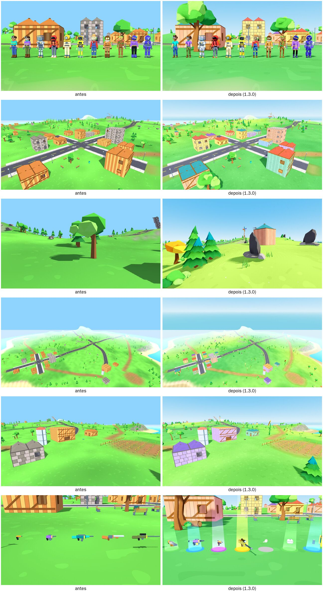

# Guia de estilo visual — Ventania

Direção (revisão de arte 1.3.0): **cartum caprichoso e levemente torto, original.**
Formas grandes e amigáveis, cores saturadas com tons pastel nas casas, silhuetas
legíveis de longe, um toque de imperfeição intencional (troncos curvos, paredes
envergadas, telhados coloridos, marcos surreais) e custo baixo de GPU. A
inspiração é o *clima* dos battle royales cartunescos (alegre, colorido, com
humor), nunca os assets, personagens, mapas ou texturas de qualquer jogo.



*Mesmos ângulos, mesmo mapa, mesma luz do jogo (`game/tests/capturar_visual.gd`).
Fotos completas em `docs/art/antes/` e `docs/art/depois/`.*

### O que mudou na 1.3.0

| Área | Antes | Depois |
|---|---|---|
| Personagens | manequins de peças rígidas, rosto em traços | corpo contínuo com pesos suaves, olhos com íris/pálpebra/cílios, sobrancelhas, nariz, boca, orelhas, cabelo em mechas, roupas em camadas com barras e costuras |
| Skins | 11 trajes sobre o manequim | as 11 refeitas uma a uma, mantendo a identidade (aquário, monitor, saco de espantalho, planeta, armadura de tempestade…) |
| Animação | ciclos básicos | idle com contrapposto, corrida com mais impulso e giro de tronco, peso nas curvas e arrancadas (procedural, do estado da rede) |
| Vegetação | 1 árvore, 1 pinheiro, 1 moita, 1 pedra | 12 modelos (folhosas, outono, pinheiros, moitas, flores, capim, 3 pedras), em grupos naturais |
| Terreno | verde uniforme | 4 tons de grama por região, encostas escuras, flores, areia molhada, estratos na rocha, beira de caminho |
| Casas | caixas listradas laranja/cinza | paredes pastel e telhados coloridos por casa, envergadura suave |
| Marcos | — | cata-vento gigante, farol torto, girassol gigante, cogumelos gigantes, pedras equilibradas |
| Armas/itens | blocos simples | miras, guarda-mato, quebra-chamas, lunetas, baú de tábuas com tampa abaulada; loot com coluna de luz por raridade |
| Luz | cor de fundo chapada | céu em degradê, luz em 3 faixas, oclusão ambiente assada por vértice, tonemap/brilho por perfil |

## 1. Princípios

1. **A silhueta vem antes do detalhe.** Se a forma não se lê em 30 px de altura, simplifique.
2. **Cor chapada vem antes da textura.** Cada peça tem uma cor da paleta e nada de texturas pintadas. O volume vem do shader.
3. **Exagero controlado.** Cabeças, mãos e pés maiores, com cantos levemente arredondados (chanfro).
4. **Cor tem função.** Construções do jogador em tons quentes (madeira) e neutros (pedra/metal). Loot em azul-petróleo com amarelo. Personagens sempre com um acento de cor forte (o cachecol coral do recruta).
5. **Identidade própria.** O tema do jogo é **vento**: redemoinhos, cachecóis, óculos de aviador, cata-ventos e bandeirolas. Nada imita personagens, itens ou locais de outros jogos.

## 2. Paleta

- Fonte da verdade: `tools/assets/kit/paleta.json`, com 40 cores (máximo de 64).
- Atlas gerado em `game/assets/texturas_materiais/paleta_ventania.png` (256×256, células de 32 px). Células vazias ficam em magenta, para um erro de UV aparecer na hora.
- **Mudar uma cor na paleta muda o jogo inteiro sem reexportar modelos.** Rode `python3 tools/assets/kit/gerar_paleta_png.py`.
- Para adicionar uma cor, coloque-a no **fim** da lista. Inserir no meio desloca as células e quebra os assets já exportados.

| Grupo | Cores |
|---|---|
| Construção | madeira_clara/media/escura, pedra_clara/media/escura, metal_claro/escuro |
| Natureza | folha_clara/media/escura, tronco, grama, terra, agua, areia |
| Pele | pele_1 a pele_4 |
| Acentos | teal, teal_escuro, coral, amarelo_sol, roxo, rosa, laranja, dourado, vermelho |
| Neutros | branco, preto, cinza_tecido, jeans, couro, verde_militar |
| Especiais | azul_tormenta (a Tormenta), lente, azul_ceu |

## 3. Material e shader

- **Um material para o kit inteiro:** `M_paleta_ventania.tres` (ShaderMaterial com `toon_paleta.gdshader`).
- No Blender, use só o material `M_paleta_ventania` (criado por `kit_comum.material()`). O exportador grava apenas o nome, e a Godot troca pelo material compartilhado na importação (`post_import.gd`).
- O shader tem luz em **3 faixas** (sombra, meio-tom, luz) com transição curta, sombra puxada para azul e brilho de borda leve. Compatível com GLES3, sem texturas extras.
- **Oclusão ambiente assada por vértice**: o exportador (`export_glb.py`) lança raios na própria malha e grava em `COLOR` (raio por categoria; personagens 7 cm, cenário 45 cm). Cantos, axilas e o pé das árvores escurecem sem custo em tempo de execução.
- **Variação de pintura** (manchas suaves + grão) por pixel, desligada no detalhe baixo pelo uniform global `detalhe_arte`.
- **Construções do mapa** (MultiMesh, `INSTANCE_CUSTOM`): `.z` = pintura (tabela `TINTAS`: 5 pastéis de parede, 3 cores de telhado), `.w` = "torto": envergadura de até 12 cm, função contínua da posição no mundo, então as emendas entre peças continuam fechadas e a colisão continua valendo. Construções do jogador ficam retas e sem pintura.
- Ajustes artísticos ficam nos uniforms do material (`cor_sombra`, `limite_luz`, `suavidade`, `forca_rim`), não no código.

## 4. Proporções e escala

| Elemento | Medida |
|---|---|
| Personagem | cerca de 1,88 m. Cabeça com cerca de 1/4,5 da altura, olhos grandes. Mãos e pés grandes |
| Célula de construção | 4 × 4 × 4 m. Espessura das paredes 0,22 m |
| Baú | 1,1 × 0,7 × 0,68 m (fechado) |
| Árvores | 4,5–7 m. Tronco curvo com base alargada; copa em "nuvens" com calombos contínuos |
| Marcos | 8–14 m, visíveis a 500–600 m |

## 5. Personagens

- **Esqueleto padrão** com os nomes do `SkeletonProfileHumanoid` da Godot (20 ossos em T-pose). **Todo traje usa este esqueleto**, e as hitboxes são iguais para todos (gameplay não muda com a skin).
- **Biblioteca** `tools/assets/kit/blender/estilo_personagem.py`:
  - corpo contínuo (modificador Skin sobre um grafo de juntas + subdivisão 1), tipos `padrao`, `fino`, `robusto`;
  - pesos suaves por distância aos ossos (até 3 influências, só entre ossos vizinhos): ombros, cotovelos e joelhos dobram sem quebrar;
  - **roupas são cascas** do próprio corpo, recortadas por planos (`casca`, `faixa`, `entre_z`, `ate_x`) e afastadas pela normal: herdam os pesos e deformam junto;
  - cabeça, olhos (branco, íris, pupila, 2 brilhos, pálpebra, cílios), sobrancelhas, nariz, boca, orelhas, cabelo em mechas (`topete`, `bagunca`, `rabo`), mãos com dedos, calçados com sola e cadarço.
- Skins em `gerar_skins.py`: cada uma tem a sua função, com identidade própria (não é troca de cor). Para criar uma nova, copie a função mais parecida.
- Rosto: olhos grandes e expressivos com pálpebra a 1/3, sorriso de canto, sobrancelha levemente inclinada. Sem copiar rostos de personagens existentes.
- **Proporções (1.4)**: "herói cartunesco" — cabeça 10% maior que o natural (`ESCALA_CABECA`, todas as peças do osso Head escalam juntas; capacetes já grandes ficam em 1.0), ombros largos e cintura marcada, membros que AFINAM nas juntas (deltoide, bíceps, antebraço, coxa, panturrilha atrás, canela; pulso e tornozelo finos), pescoço firme, mãos "gordinhas" com dedos dobrados e pés grandes. O grafo de juntas tem uma junta por volume e é suavizado depois da subdivisão (sem degraus entre raios).
- **Roupas com folga**: `casca(..., folga=f)` afasta cada vértice pela normal com um extra que depende da posição — mangas mais largas que o braço e abrindo na ponta, barra solta no quadril, boca da calça caindo sobre o calçado, jaqueta fofa.
- **Cabelo cobre a nuca** (volume `nuca` + calota que desce atrás das orelhas): nada de "careca" na vista de trás.

## 5.2 Animação (1.4)

- **Autoria pose a pose** em `tools/assets/kit/blender/animacoes.py`: cada clipe é uma lista de poses-chave; entre elas, spline Catmull-Rom (o movimento passa pelas poses sem parar); cada osso tem um **atraso** (cabeça, antebraços e mãos chegam depois do tronco = sobreposição); ciclos de passada são escritos para um lado e **espelhados** automaticamente.
- **Locomoção**: parado (contrapposto, respiração, olhada, troca de peso) → caminhar (1,8 m/s) → corrida (4,5 m/s, velocidade padrão) → sprint (6,5 m/s), misturados pela velocidade replicada; agachado e andar agachado; pular (impulso → encolhe), queda (braços "nadando"), aterrissar (amortece fundo, passa e assenta). Os ciclos têm contato, descida, passagem e subida/voo.
- **Armas**: as mãos ficam presas à arma pelo IK (ItemRig); tiro, recarga e troca ganham **reações do tronco** feitas no Blender e SOMADAS na Godot (OneShot ADD com filtro só em Spine/Chest/Neck/Head/ombros). Como a arma segue o peito, o coice e a recarga movem a arma. A recarga estica para a duração da arma.
- **Eliminação**: clipe `eliminado` (golpe, cambaleia, joelhos, tomba) tocado numa cópia com o traje da vítima, e o vento leva o corpo num redemoinho (`EliminacaoVisual`). Disparado pelo evento de eliminação que todos os clientes já recebem.
- **Conferir**: folha de quadros `game/tests/capturar_anim.gd`, teste `tests/integration/test_animacoes.gd`.

## 5.1 Cenário

- **Vegetação** (`gerar_cenario.py`): troncos tubulares curvos com raízes, copas em nuvem decimadas, pinheiros de camadas com pontas caídas, pedras facetadas por cortes planos, musgo. Distribuição em grupos (`_vegetacao` + `_ao_pe` em `ilha_ventania.gd`).
- **Marcos** (`gerar_marcos.py`): um por POI, grande, torto e com humor; peças que giram usam o nó `Girador` (só cliente).
- **Casas**: a paleta de cada casa sai de um hash da posição (determinístico, igual no servidor e no cliente, sem gastar o sorteio do mapa).
- Escadas reais (degraus) nos edifícios de vários andares; nunca rampa no lugar de escada.

## 6. Orçamentos do kit atual (medidos, 1.3.0)

| Asset | Triângulos | Orçamento |
|---|---|---|
| personagens (11 trajes, 1.4) | 4.366–8.384 | 8.500 (a Godot gera LODs) |
| bau_ventania_01 | 848 | 1.000 |
| armas | 436–920 | 1.500 |
| itens (munição, cura, escudo) | 156–476 | 1.000 |
| árvores | 536–904 | 2.500 |
| pinheiros | 248–302 | 2.500 |
| moitas, flores, capim, pedras | 44–780 | 2.500 |
| marcos | 256–2.212 | 2.500 |
| paredes, pisos e rampas | 108–192 | 300 |

Custo por perfil (`tests/perf/bench_mapa.gd`, mesma máquina, render por software,
12 personagens animados na tela): Desempenho 25 FPS (1% pior 16), Equilibrado 13,5,
Qualidade 4,9. Na 1.2.1 eram 29 / 18 / 9,2: a arte nova custa mais nos perfis
altos, sobretudo pelos personagens com sombra em 2 divisões. Em GPU de verdade a
diferença é bem menor; para PC fraco e celular, use Desempenho ou Equilibrado.

O que cada perfil liga (nível de detalhe):

| | Baixo | Médio | Alto |
|---|---|---|---|
| Ruídos de pintura por pixel (kit e terreno) | não | sim | sim |
| Céu em degradê | não (cor) | sim | sim |
| Tonemap filmic | não | sim | sim |
| Ajuste de cor e brilho (glow) | não | não | sim |
| Troca de LOD (limite em pixels) | 6 | 2,5 | 1 |
| Densidade da vegetação decorativa | 45% | 80% | 100% |

## 7. Como gerar ou alterar o kit

```bash
python3 tools/assets/kit/construir_kit.py --blender-python .venv-bpy/bin/python --godot godot
```

Esse comando gera os `.blend`, exporta, valida, importa e registra tudo no
catálogo. Para editar à mão no Blender, abra o `.blend` em `assets_src/` e rode o
mesmo comando com `--so-exportar`, para não sobrescrever a edição.

Para renderizar a vitrine (no Linux sem tela, use `xvfb-run`):

```bash
godot --path game --rendering-driver opengl3 --resolution 1280x720 -s res://tests/vitrine_kit.gd -- vitrine.png quality
```

Fotos de comparação (antes/depois, mesmos ângulos):

```bash
xvfb-run -a godot --path game --rendering-driver opengl3 --resolution 1280x720 -s res://tests/capturar_visual.gd -- pasta_saida
```

Giro de 4 vistas de um traje e fileira de props:

```bash
xvfb-run -a godot --path game --rendering-driver opengl3 -s res://tests/capturar_traje.gd -- saida.png res://assets/personagens/recruta_base_01.glb idle 0.5
xvfb-run -a godot --path game --rendering-driver opengl3 -s res://tests/capturar_props.gd -- saida.png 4 18 res://assets/cenario/arvore_redonda_01.glb
```

## 8. Próximos passos de arte

- Detalhes decorativos nas casas (chaminés, toldos, floreiras) presos às peças, para sumirem junto quando a parede é destruída.
- Mais variações de cabelo e rosto para trajes futuros, sobre a mesma biblioteca.
- Animação de recarga por arma mais expressiva (hoje é procedural no ItemRig).
