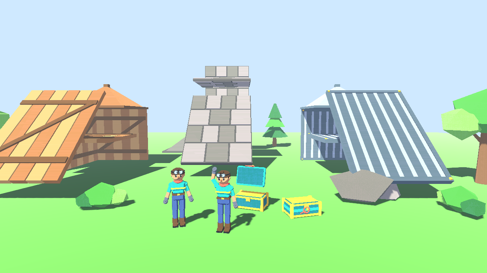

# Guia de estilo visual — Ventania

Direção: **cartunesco clássico, original.** Formas grandes e amigáveis, cores
saturadas, leitura instantânea a distância, custo mínimo de GPU.



*Renderizado na Godot 4.7.2, renderizador Compatibility, com `game/tests/vitrine_kit.gd`.
Perfil Quality: 58 draw calls e cerca de 17,6 mil primitivas. Perfil Performance (sem sombras):
29 draw calls e cerca de 8,8 mil primitivas.*

## 1. Princípios

1. **A silhueta vem antes do detalhe.** Se a forma não se lê em 30 px de altura, simplifique.
2. **Cor chapada vem antes da textura.** Cada peça tem uma cor da paleta e nada de texturas pintadas. O volume vem do shader.
3. **Exagero controlado.** Cabeças, mãos e pés maiores, com cantos levemente arredondados (chanfro).
4. **Cor tem função.** Construções do jogador em tons quentes (madeira) e neutros (pedra/metal). Loot em azul-petróleo com amarelo. Personagens sempre com um acento de cor forte (o cachecol coral do recruta).
5. **Identidade própria.** O tema do jogo é **vento**: redemoinhos, cachecóis, óculos de aviador, cata-ventos e bandeirolas. Nada imita personagens, itens ou locais de outros jogos.

## 2. Paleta

- Fonte da verdade: `tools/assets/kit/paleta.json`, com 40 cores (máximo de 64).
- Atlas gerado em `game/assets/texturas_materiais/paleta_ventania.png` (256×256, células de 32 px). Células vazias ficam em magenta, para um erro de UV aparecer na hora.
- **Mudar uma cor na paleta muda o jogo inteiro sem reexportar modelos.** Rode `python3 tools/assets/kit/gerar_paleta_png.py`.
- Para adicionar uma cor, coloque-a no **fim** da lista. Inserir no meio desloca as células e quebra os assets já exportados.

| Grupo | Cores |
|---|---|
| Construção | madeira_clara/media/escura, pedra_clara/media/escura, metal_claro/escuro |
| Natureza | folha_clara/media/escura, tronco, grama, terra, agua, areia |
| Pele | pele_1 a pele_4 |
| Acentos | teal, teal_escuro, coral, amarelo_sol, roxo, rosa, laranja, dourado, vermelho |
| Neutros | branco, preto, cinza_tecido, jeans, couro, verde_militar |
| Especiais | azul_tormenta (a Tormenta), lente, azul_ceu |

## 3. Material e shader

- **Um material para o kit inteiro:** `M_paleta_ventania.tres` (ShaderMaterial com `toon_paleta.gdshader`).
- No Blender, use só o material `M_paleta_ventania` (criado por `kit_comum.material()`). O exportador grava apenas o nome, e a Godot troca pelo material compartilhado na importação (`post_import.gd`).
- O shader tem luz em 2 faixas com transição curta, sombra puxada para azul e brilho de borda leve. Ele é compatível com GLES3 e não usa texturas extras.
- Ajustes artísticos ficam nos uniforms do material (`cor_sombra`, `limite_luz`, `suavidade`, `forca_rim`), não no código.

## 4. Proporções e escala

| Elemento | Medida |
|---|---|
| Personagem | cerca de 1,88 m. Cabeça com cerca de 1/4,5 da altura. Mãos e pés grandes |
| Célula de construção | 4 × 4 × 4 m. Espessura das paredes 0,22 m |
| Baú | 1,1 × 0,7 × 0,68 m (fechado) |
| Árvores | 4,5–5,5 m. Copa em blobs (icosfera com ruído) |

## 5. Personagens

- **Esqueleto padrão** com os nomes do `SkeletonProfileHumanoid` da Godot (Hips, Spine, Chest, Neck, Head, Left/Right Shoulder, UpperArm, LowerArm, Hand, UpperLeg, LowerLeg, Foot), mais Root. São 20 ossos em T-pose. **Todo traje usa este esqueleto**, e as hitboxes são iguais para todos.
- Skinning rígido por partes: barato, estável em GLES3 e coerente com o visual de peças arredondadas. As juntas são cobertas por esferas (cotovelo, joelho, ombro).
- **Traje = cores + acessórios** sobre a mesma base. Um traje novo começa copiando `gerar_personagem.py` e trocando as constantes de cor e as peças da cabeça e do tronco.
- Rosto simples: olhos ovais pretos com brilho, sobrancelhas, nariz redondo e boca em traço.

## 6. Orçamentos do kit atual (medidos)

| Asset | Triângulos | Orçamento |
|---|---|---|
| recruta_base_01 | 2.790 | 6.000 |
| bau_ventania_01 | 376 | 800 |
| paredes, pisos e rampas | 108–192 | 300 |
| tetos | 30 | 300 |
| árvores, pinheiro, pedra, arbusto | 40–108 | 2.500 |

## 7. Como gerar ou alterar o kit

```bash
python3 tools/assets/kit/construir_kit.py --blender-python .venv-bpy/bin/python --godot godot
```

Esse comando gera os `.blend`, exporta, valida, importa e registra tudo no
catálogo. Para editar à mão no Blender, abra o `.blend` em `assets_src/` e rode o
mesmo comando com `--so-exportar`, para não sobrescrever a edição.

Para renderizar a vitrine (no Linux sem tela, use `xvfb-run`):

```bash
godot --path game --rendering-driver opengl3 --resolution 1280x720 -s res://tests/vitrine_kit.gd -- vitrine.png quality
```

## 8. Próximos assets sugeridos

Armas (5 arquétipos do GAME_DESIGN), ferramenta de coleta, 2–3 trajes variantes,
mochila, planador, caixa de munição, curativos/células de escudo, casas e props
de ponto de interesse.
